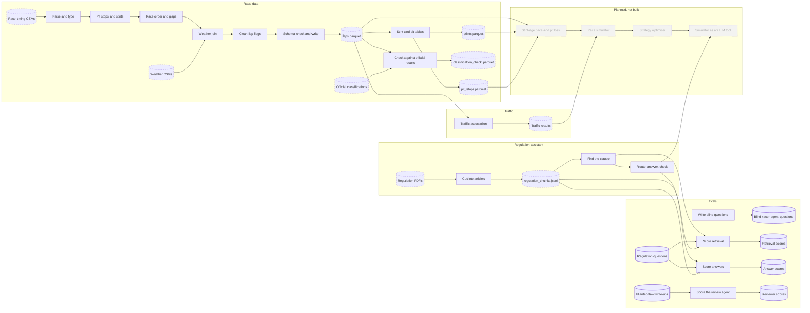

# Endurance Pit Strategy Planner

In a six or twenty-four hour race a team has to decide when to stop and who drives next, all while guessing how much time the slower cars in the other class are going to cost them. Most of that is judgement. I wanted to see how far I could get with real timing data and some honest statistics.

This repo is that attempt. It starts from the public FIA WEC lap timing and works towards a race simulator that can compare pit strategies.
The question I'm working towards:

> For a given car, circuit and race length, when should the team pit? Once driver pace, stint length, pit losses, traffic from the other class and the odd safety car are accounted for and how sure can we be about that answer?

## Where it's at

The data pipeline and the traffic study are done, and the regulation assistant is mostly built and tested. The simulator is next, after the pace and pit-loss models.

### Data pipeline (layer 1, done)

- **One command builds everything.** `python -m endurance_strategy.pipeline` takes the raw race and weather files to validated Parquet tables (laps, stints, pit stops) in under 20 seconds on a laptop.
- **21 races from 2024 to 2026:** 179,259 laps from 833 car entries, split into 10,577 stints. 138,189 laps pass the clean-lap rules, which also catch field-wide slow periods the rain sensor misses, such as a drying track or slow zones (D-025).
- **Pit stops and stints.** In-laps, out-laps and driver changes are flagged, and garage visits are kept apart from normal stops.
- **Weather on every lap,** joined by time of day rather than the race clock, because the race clock stops during red flags. At Spa 2024 the race clock would have put the weather two hours out.
- **Race order and gaps** are rebuilt at every timing-line crossing in DuckDB SQL. Lap counts match the official classification for 830 of 833 cars, and the finishing-time differences fit post-race penalties (E-007).

### Traffic (layer 2, done)

- **Hypercar behind GT3:** within the same stint, a Hypercar lap is about 0.37 s longer for each LMGT3 car close enough ahead at the start of the lap to be caught (0.33 to 0.41 s, resampling 18 races). Laps with one such car against none differ by about 0.4 s however "close enough" is defined (E-013).
- **GT3 ahead of Hypercar:** a GT3 lap is about 0.18 s longer (0.16 to 0.20) for each Hypercar close behind. Both figures hold when only laps already finished are used, and 2026 lines up with 2024 and 2025 at the same tracks (E-014).
- **Le Mans, three classes:** the faster car's figure is the larger in every class pair, but only 2025 and 2026 are usable. A damp, drying track in 2024 leaves half the laps flagged slow (E-015).

These are associations with inferred traffic, not a measured cost per overtake. Timing data can't see passes.

### Regulation assistant (layer 6, mostly built)

- **Retrieval:** the 2024 to 2026 sporting regulations are split into article-level chunks with season and page, and searched with BM25. It finds the right 2026 clause in the top 5 for 24 of 30 hand-written questions (E-009).
- **BM25 against embeddings:** a hybrid of BM25 and a small embedding model won 5 questions to 1 on fresh and vague questions, but the sign test fixed before the run gave p = 0.22, so BM25 stays the default. On the vague questions BM25 found the clause for only 9 of 18, so retrieval is where the assistant most needs to improve (E-011, E-017). A second test on fresh questions, with its rule fixed before the questions exist, is set up (E-019).
- **Grounded answers:** a router sends strategy questions away, because pit timing has to come from the simulator. Rules questions are answered only from the retrieved clauses, and a plain-code checker rejects any answer whose citations, quotes or numbers don't trace back. For the 24 questions where retrieval found the right clause, the answer cited it in all 3 runs of each (E-010).
- **Declining what it can't support:** on 5 real racing questions the regulations don't cover, it declined every time instead of guessing. The checker also rejected 2 correct answers, and refusal text isn't checked yet. Both are next on the list (E-018).

See [`evals/regulations/`](evals/regulations/).

### Checks on the AI tools

- **An eval for the AI review agent:** 16 synthetic write-ups with planted statistical flaws and clean controls, run headless through Claude Code and scored in code against labels. It caught 11 of the 12 flaws (E-008). See [`evals/statistical_reviewer/`](evals/statistical_reviewer/).
- **183 tests on synthetic data,** run in GitHub Actions on every push, with no real data needed.

The full log of what's been tried, including null results, is in [`docs/EXPERIMENT_LOG.md`](docs/EXPERIMENT_LOG.md), and the reasoning behind the bigger choices is in [`docs/DECISIONS.md`](docs/DECISIONS.md).

## The plan

The build goes in layers. Each one has to work before the next one leans on it.

1. **Data pipeline** (done)
   - Raw files to clean, validated tables (Parquet and DuckDB).
2. **Race order and traffic** (done)
   - Rebuild who was where on track, then look at how lap times change when a faster car is working through slower traffic.
3. **Pace, stints and pit loss** (next)
   - How pace fades through a stint, and what a stop actually costs.
4. **Simulator**
   - A lap-by-lap race model, deterministic first, then with randomness added one piece at a time and checked against real races.
5. **Optimiser**
   - Search the legal pit windows and compare strategies with intervals rather than single numbers.
6. **Regulation assistant** (mostly built; the simulator tool is still to come)
   - An LLM that can look up the sporting regulations, call the simulator as a tool and explain the result with citations. It explains the answer but never makes the numbers up.

Reinforcement learning is a maybe for the very end, and only if the simulator holds up against real races first. An RL agent trained on a bad simulator just learns the simulator's mistakes.

## How the data moves

Cylinders are stored files and rectangles are steps. Dashed cylinders stay on my laptop because the source data can't be shared, and the faint boxes aren't built yet. The graph is generated, and a test fails if it stops matching the code. [`docs/LINEAGE.md`](docs/LINEAGE.md) adds the files and libraries behind each step and the import graph.

<!-- lineage:begin -->

<!-- lineage:end -->

## A few things I'm being careful about

- **Timing data can't see overtakes.** There's no GPS here, just line crossings and sector times. So the traffic work looks at inferred exposure to slower cars and the lap time that goes with it, not individual passes.
- **Fuel and tyres can't be separated.** Both get worse as a stint goes on, and timing alone can't tell them apart. I model the combined stint effect and treat any split as an assumption.
- **The team's real strategy isn't the right answer.** They have telemetry and radio I don't. Comparing against it is context, not a score.
- **Laps aren't independent.** 179,259 laps sounds like a lot, but they come from 21 races and 833 car entries. Results get split by race (fit on 2024, validate on 2025, test on 2026), never by shuffling laps.
- **Outside Le Mans this is a two-class race.** Since 2024 the championship rounds are Hypercar and LMGT3 only, with LMP2 turning up at Le Mans alone. So I say two-class where that's what the data is.

## Running it

```bash
git clone https://github.com/kaloyankirovgit/endurance-pit-strategy.git
cd endurance-pit-strategy
python -m venv .venv && source .venv/bin/activate
pip install -e ".[dev]"
git config core.hooksPath .githooks
pytest -q
```

The `git config` line turns on a pre-commit hook that stops anything git-ignored from being committed, which matters here because the timing data can't be shared.

The tests run on a small synthetic race in `tests/fixtures/`, so they don't need the real data.

## Getting the data

The timing data belongs to Al Kamel Systems and can't be redistributed, so none of it is in this repo. That covers the raw files and anything derived from them.

It's free to download for your own use from <https://fiawec.alkamelsystems.com/>. Pick a season and event, open the race session and grab the `23_Analysis_Race_Hour NN.CSV` file with the highest hour (it covers the whole race). Save it as `data/raw/wec/<YEAR>_<CIRCUIT>.CSV`, for example `2025_LE_MANS.CSV`, and then:

```python
from endurance_strategy.io.load import load_race_csv
from endurance_strategy.paths import race_path
from endurance_strategy.reconstruct.stints import add_stint_columns

laps = add_stint_columns(load_race_csv(race_path("2025_LE_MANS")))
```

More detail on the source, including a quirk where the site sometimes serves the wrong event, is in [`docs/research/data_sources.md`](docs/research/data_sources.md).

## How it's built

This project is built in close collaboration with Claude Code, Anthropic's coding agent. AI assistance runs through most of it, so it's worth saying plainly how that works.

- **Where Claude helps:** writing and editing the pipeline code, the tests and CI, the write-ups in `docs/`, and running the review agents and evals.
- **Where I come in:** I set the direction and the standards, and I review every change before it's committed. Every commit goes through me, and I'm accountable for what's in the repo.
- **How the work is kept honest:**
  - [`CLAUDE.md`](CLAUDE.md) and [`.claude/rules/`](.claude/rules/) set the standards Claude works to, from data licensing to how statistical results are allowed to be worded.
  - Review agents in [`.claude/agents/`](.claude/agents/) check code, data, statistics and the simulator before a result is reported. The statistical reviewer is itself evaluated against planted flaws in [`evals/`](evals/).
  - A commit hook blocks the licensed timing data from being committed, whether Claude or I run the commit (D-016).

The setup is part of the project, not just tooling around it. A lot of the work here is about running an AI-assisted workflow where the checks are enforced rather than hoped for.

This is an independent project. It isn't affiliated with the FIA, the ACO, the WEC or Al Kamel Systems.
