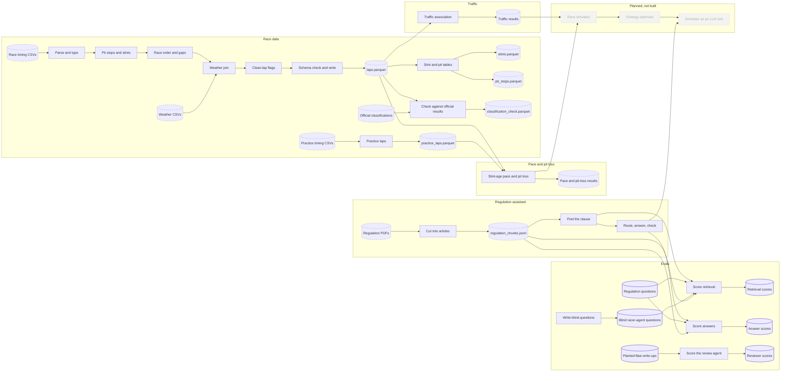

# Lineage

Generated by `python -m endurance_strategy.lineage`. Don't edit this file by hand: `tests/test_lineage.py` fails if it differs from the generator.

## Where the data goes

Cylinders are stored files and rectangles are steps. A dashed cylinder stays on the laptop because the source data can't be redistributed. A thick cylinder is committed to Git. The faint boxes aren't built yet.

The graph is declared in `src/endurance_strategy/lineage.py`. The tests check that it has no cycles, that every file and function it names exists, that every library it lists is imported by that step's files, and that every Python file in the project is placed in it. They can't prove every arrow is right.

It doesn't run anything. The pipeline is one command that takes under 20 seconds on a laptop, so there's nothing yet for a scheduler to do (D-028).

## What each step uses

| Step | Files | Libraries | Methods |
|---|---|---|---|
| Parse and type | `io/load.py` | pandas | Parsing `m:ss.SSS` durations and the semicolon format |
| Pit stops and stints | `reconstruct/stints.py` | pandas | In-lap and out-lap flags, stint numbering, garage-visit outliers |
| Race order and gaps | `reconstruct/race_order.py` | duckdb | SQL window functions over lap crossings |
| Weather join | `features/weather.py` `reconstruct/race_clock.py` `io/weather.py` | pandas | As-of join on UTC, with each circuit's time zone |
| Clean-lap flags | `features/clean_laps.py` | pandas, numpy | Flag and keep, never delete. Rule-based exclusions |
| Schema check and write | `pipeline.py` `validation/schema.py` | pandera, pandas | Data contract validated on write, Parquet storage |
| Practice laps | `pipeline.py` `reconstruct/stints.py` | pandas | One table per session type, no clean-lap rule until one is registered |
| Stint and pit tables | `pipeline.py` | duckdb | SQL aggregation into analysis tables |
| Check against official results | `validation/classification.py` | duckdb, pandas | Reconciling a rebuilt result with an independent source |
| Traffic association | `features/traffic.py` `models/traffic.py` `scripts/run_traffic_baseline.py` `scripts/run_traffic_followup.py` `scripts/run_traffic_le_mans.py` | pandas, numpy | Within-stint comparison, cluster bootstrap over races, placebo windows, temporal holdout |
| Cut into articles | `rag/regulations.py` | pypdf | Chunking on document structure, with season and page metadata |
| Find the clause | `rag/retrieve.py` `rag/embed.py` | fastembed, numpy | BM25 (the default), embeddings, reciprocal rank fusion, season filter |
| Route, answer, check | `rag/answer.py` `llm.py` | standard library | Routing, prompt chaining, structured output, deterministic checker, refusal |
| Write blind questions | `rag/racer_agent.py` `scripts/run_racer_agent.py` `llm.py` | standard library | Isolated headless agent, persona prompts, canary check, order fixed before the run |
| Score retrieval | `rag/evaluate.py` `scripts/run_retrieval_eval.py` `scripts/run_retrieval_comparison.py` `scripts/measure_retrieval_cost.py` `scripts/run_e019.py` | standard library | recall@k, held-out sets, pre-registered paired sign test |
| Score answers | `rag/evaluate.py` `scripts/run_answer_eval.py` | standard library | Repeated runs, full trace logging, scoring in code against labels |
| Score the review agent | `evals/reviewer.py` `scripts/run_reviewer_eval.py` `llm.py` | standard library | Planted flaws and clean controls, headless runs, exact-match scoring |
| Stint-age pace and pit loss | `models/pace.py` `scripts/run_layer3.py` | pandas, numpy, pyarrow | Within-stint fits with races as the unit, decision ladder against baselines, frozen fit then one held-out check, sealed season |

Files that do real work but aren't a stage in the flow:

- `paths.py`: Where each data folder lives
- `lineage.py`: This file
- `io/download.py`: Finds and fetches new race, practice, weather and classification files
- `scripts/ingest.py`: One command: fetch anything new, check it and rebuild the tables
- `io/regulations.py`: Fetches the regulation PDFs
- `validation/quality.py`: Structural checks, run from the tests
- `scripts/guard_commit.py`: Blocks commits of git-ignored files

## Which code imports which

Read from the code, so it can't be out of date.

```mermaid
flowchart LR
  subgraph g0["evals"]
    n_evals_reviewer["reviewer"]
  end
  subgraph g1["features"]
    n_features_clean_laps["clean_laps"]
    n_features_traffic["traffic"]
    n_features_weather["weather"]
  end
  subgraph g2["io"]
    n_io_download["download"]
    n_io_load["load"]
    n_io_regulations["regulations"]
    n_io_weather["weather"]
  end
  subgraph g3["models"]
    n_models_pace["pace"]
    n_models_traffic["traffic"]
  end
  subgraph g4["rag"]
    n_rag_answer["answer"]
    n_rag_embed["embed"]
    n_rag_evaluate["evaluate"]
    n_rag_racer_agent["racer_agent"]
    n_rag_regulations["regulations"]
    n_rag_retrieve["retrieve"]
  end
  subgraph g5["reconstruct"]
    n_reconstruct_race_clock["race_clock"]
    n_reconstruct_race_order["race_order"]
    n_reconstruct_stints["stints"]
  end
  subgraph g6["scripts"]
    n_scripts_guard_commit["guard_commit"]
    n_scripts_ingest["ingest"]
    n_scripts_measure_retrieval_cost["measure_retrieval_cost"]
    n_scripts_run_answer_eval["run_answer_eval"]
    n_scripts_run_e019["run_e019"]
    n_scripts_run_layer3["run_layer3"]
    n_scripts_run_racer_agent["run_racer_agent"]
    n_scripts_run_retrieval_comparison["run_retrieval_comparison"]
    n_scripts_run_retrieval_eval["run_retrieval_eval"]
    n_scripts_run_reviewer_eval["run_reviewer_eval"]
    n_scripts_run_traffic_baseline["run_traffic_baseline"]
    n_scripts_run_traffic_followup["run_traffic_followup"]
    n_scripts_run_traffic_le_mans["run_traffic_le_mans"]
  end
  subgraph g7["top level"]
    n_lineage["lineage"]
    n_llm["llm"]
    n_paths["paths"]
    n_pipeline["pipeline"]
  end
  subgraph g8["validation"]
    n_validation_classification["classification"]
    n_validation_quality["quality"]
    n_validation_schema["schema"]
  end
  n_features_weather --> n_io_weather
  n_io_download --> n_paths
  n_io_regulations --> n_paths
  n_lineage --> n_paths
  n_models_pace --> n_features_clean_laps
  n_models_pace --> n_io_load
  n_models_pace --> n_models_traffic
  n_models_traffic --> n_features_clean_laps
  n_pipeline --> n_features_clean_laps
  n_pipeline --> n_features_weather
  n_pipeline --> n_io_download
  n_pipeline --> n_io_load
  n_pipeline --> n_io_weather
  n_pipeline --> n_paths
  n_pipeline --> n_reconstruct_race_clock
  n_pipeline --> n_reconstruct_race_order
  n_pipeline --> n_reconstruct_stints
  n_pipeline --> n_validation_schema
  n_rag_answer --> n_llm
  n_rag_answer --> n_rag_retrieve
  n_rag_embed --> n_rag_retrieve
  n_rag_evaluate --> n_rag_answer
  n_rag_evaluate --> n_rag_retrieve
  n_rag_racer_agent --> n_llm
  n_reconstruct_race_clock --> n_paths
  n_scripts_ingest --> n_io_download
  n_scripts_ingest --> n_paths
  n_scripts_ingest --> n_pipeline
  n_scripts_ingest --> n_validation_classification
  n_scripts_measure_retrieval_cost --> n_paths
  n_scripts_measure_retrieval_cost --> n_rag_embed
  n_scripts_measure_retrieval_cost --> n_rag_retrieve
  n_scripts_run_answer_eval --> n_paths
  n_scripts_run_answer_eval --> n_rag_answer
  n_scripts_run_answer_eval --> n_rag_evaluate
  n_scripts_run_answer_eval --> n_rag_retrieve
  n_scripts_run_e019 --> n_paths
  n_scripts_run_e019 --> n_rag_embed
  n_scripts_run_e019 --> n_rag_evaluate
  n_scripts_run_e019 --> n_rag_retrieve
  n_scripts_run_layer3 --> n_features_clean_laps
  n_scripts_run_layer3 --> n_features_traffic
  n_scripts_run_layer3 --> n_models_pace
  n_scripts_run_layer3 --> n_paths
  n_scripts_run_racer_agent --> n_rag_racer_agent
  n_scripts_run_retrieval_comparison --> n_paths
  n_scripts_run_retrieval_comparison --> n_rag_embed
  n_scripts_run_retrieval_comparison --> n_rag_evaluate
  n_scripts_run_retrieval_comparison --> n_rag_retrieve
  n_scripts_run_retrieval_eval --> n_paths
  n_scripts_run_retrieval_eval --> n_rag_evaluate
  n_scripts_run_retrieval_eval --> n_rag_retrieve
  n_scripts_run_reviewer_eval --> n_evals_reviewer
  n_scripts_run_reviewer_eval --> n_llm
  n_scripts_run_traffic_baseline --> n_features_traffic
  n_scripts_run_traffic_baseline --> n_io_load
  n_scripts_run_traffic_baseline --> n_models_traffic
  n_scripts_run_traffic_baseline --> n_paths
  n_scripts_run_traffic_followup --> n_features_traffic
  n_scripts_run_traffic_followup --> n_io_load
  n_scripts_run_traffic_followup --> n_models_traffic
  n_scripts_run_traffic_followup --> n_paths
  n_scripts_run_traffic_le_mans --> n_features_traffic
  n_scripts_run_traffic_le_mans --> n_io_load
  n_scripts_run_traffic_le_mans --> n_models_traffic
  n_scripts_run_traffic_le_mans --> n_paths
  n_validation_classification --> n_io_download
  n_validation_classification --> n_io_load
  n_validation_classification --> n_paths
```

The import graph must have no cycles. No numerical module (`io`, `reconstruct`, `features`, `validation`, `models`, `pipeline`, `simulator`, `optimiser`) may import the LLM layer (`llm`, `rag`). That rule comes from `.claude/rules/rag.md`: the LLM explains the numbers and never computes them.
